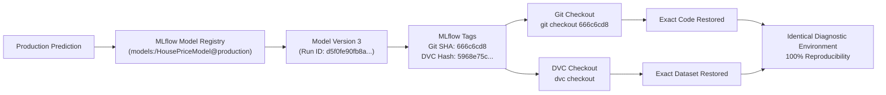

# Lab Assignment 4–5 Report: Advanced MLflow and Data Versioning with DVC

---

**Student Name:** Chirag Jindani  
**Roll Number:** 24AI020  
**Course:** Machine Learning Operations (MLOps)  
**Date:** October 17, 2026  
**Repository:** [https://github.com/CHIRAG-JINDANI/mlops-lab-4-5](https://github.com/CHIRAG-JINDANI/mlops-lab-4-5)  

---

## Executive Summary

In production machine learning systems, reproducibility cannot rely solely on source code. Changes in dataset distributions, non-deterministic hyperparameter tuning, model serialization incompatibilities, and lack of metadata governance frequently lead to the "silent decay" of production systems. 

This laboratory report addresses the core engineering question:
> **"Can another engineer identify the model that was deployed and recover the exact code and dataset version used to create it?"**

By establishing a unified MLOps tri-pillar architecture combining **Git** (code and metadata versioning), **DVC** (data tracking, content-addressable storage, and pipelines), and **MLflow** (experiment tracking, artifacts, model signatures, and model registry governance), this project demonstrates complete bidirectional traceability from an active production inference endpoint back to its exact dataset snapshot and source commit.

---

## Part A: Advanced MLflow (Lab 4)

### A1. Self-Learning Research & Core Concepts

#### 1. Model Signature
* **Definition:** A formal specification defining the expected schema of the model's inputs and outputs, including column names, primitive data types (e.g., `double`, `integer`, `string`), and dimensional shapes (scalars or tensors).
* **Practical Example:** In our California Housing regression model, the signature is inferred via `mlflow.models.infer_signature(X_train, y_pred)`. The input schema strictly requires eight 64-bit float features (`MedInc`, `HouseAge`, `AveRooms`, `AveBedrms`, `Population`, `AveOccup`, `Latitude`, `Longitude`), and the output schema enforces a 1D tensor of `float64` target predictions. If an inference payload supplies string representations or omits the `Latitude` coordinate, MLflow's pyfunc serving wrapper intercepts the request and throws a `400 Bad Request` schema validation error before computation reaches internal estimator code.

#### 2. Artifacts
* **Definition:** Heavy, non-scalar files generated during or after a model training run that provide diagnostics, model persistence, and deployment configuration.
* **Practical Example:** In this project, each run generates and records:
  1. Serialized model binaries and environment configurations (`model/model.pkl`, `MLmodel`, `requirements.txt`).
  2. High-resolution diagnostic plots (`diagnostic_plots/residuals_plot.png`, `diagnostic_plots/actual_vs_predicted.png`, `diagnostic_plots/feature_importance.png`).
  3. Structured evaluation reports (`reports/evaluation_report.json`).

#### 3. Autologging
* **Definition:** Framework-level introspection utilities (e.g., `mlflow.sklearn.autolog()`) that automatically intercept model training and log recognized hyperparameters, training/validation metrics, and model representations without explicit boilerplate logging calls.
* **Empirical Verification:** When evaluating `mlflow.sklearn.autolog()`, we verified that it recorded estimator parameters (e.g., `alpha`, `fit_intercept`, `max_iter`), training execution time, and scikit-learn standard training metrics. However, autologging alone did not capture our specific operational requirements: DVC data hashes, custom residual plots, and explicit test-set evaluation under isolated splits. Consequently, a hybrid approach—pairing autologging with explicit metric/artifact logging—is required for production safety.

#### 4. Model Registry
* **Definition:** A centralized, database-backed catalog that manages the lifecycle of trained ML models. It provides a single namespace (e.g., `HousePriceModel`), sequential versioning (v1, v2, v3), metadata tagging, model descriptions, and lifecycle governance.
* **Practical Example:** It isolates experimental scratch models from release candidates. While an experiment tracking run lives in `mlruns/` under an ephemeral Run ID, the Model Registry promotes validated runs to formal versions under `models:/HousePriceModel/`, decoupling inference clients from run identifiers.

#### 5. Version versus Stage / Alias
* **Version:** An immutable, monotonically increasing integer identifying a specific checkpoint/run of a registered model (e.g., `Version 1`, `Version 2`). A version's code, metrics, and weights never change.
* **Stage / Alias:** A mutable, human-readable pointer indicating the operational role or deployment status of a model version. 
  * *Classic MLflow Stages:* `Staging`, `Production`, `Archived`.
  * *Modern MLflow Aliases:* Named tags such as `@candidate`, `@production`, `@archived`. While a version remains permanent for auditability, the `@production` alias shifts dynamically to newer, higher-performing versions without requiring client code changes.

---

### A2. Environment and Project Setup

The project environment was initialized using Python 3.14 on macOS Apple Silicon. Exact library versions were pinned to prevent runtime regressions:

* **MLflow:** `3.17.1`
* **DVC:** `3.67.1`
* **Scikit-learn:** `1.9.1`
* **Pandas:** `3.0.6`
* **Matplotlib:** `3.11.2`
* **Tracking Store:** SQLite (`sqlite:///mlflow.db`)

```bash
# Activation and environment reproduction
python3 -m venv .venv
source .venv/bin/activate
pip install -r requirements.txt
```

---

### A3. Track and Compare Experiments

Three candidate regression models were trained on the California Housing dataset to evaluate different trade-offs between model complexity, inference latency, and predictive accuracy:

1. **Candidate 1 (`v1_ridge`):** Regularized Linear Model (Ridge Regression with $L_2$ penalty, $\alpha = 1.0$) wrapped in a `StandardScaler` pipeline. Serves as a transparent linear baseline.
2. **Candidate 2 (`v2_random_forest`):** Non-linear ensemble model (Random Forest Regressor, 100 estimators, max depth 10). Captures complex feature interactions and geographic boundaries.
3. **Candidate 3 (`v3_gradient_boosting`):** Sequential boosting model (Gradient Boosting Regressor, 200 estimators, learning rate 0.08, max depth 5). Optimized for low residual variance.

Each training run generated and logged two primary artifacts:
* **Residual Analysis Plot (`residuals_plot.png`):** Evaluates homoscedasticity and detects non-linear systematic errors across the prediction range.
* **Actual vs. Predicted Scatter Plot (`actual_vs_predicted.png`):** Measures dispersion around the ideal $y = x$ reference line.
* **Feature Importance / Coefficient Bar Chart (`feature_importance.png`):** Identifies driving factors (e.g., `MedInc`, `AveOccup`, geographical coordinates).

> 📸 **[SCREENSHOT PLACEHOLDER 1: MLflow Experiment Run Comparison Table]**  
> *Instructions: Open MLflow UI at `http://127.0.0.1:5000`. Navigate to Experiment `California_House_Price_Prediction`. Select runs `candidate_v1_ridge`, `candidate_v2_random_forest`, and `candidate_v3_gradient_boosting`. Show the metrics columns (test_rmse, test_mae, test_r2_score) and Git/DVC tags.*

---

### A4. Model Signatures and Input Examples

#### Model Signature Specification
The signature logged with each candidate model defines the schema:
* **Inputs:**
  * `MedInc`: `double` (Median income in block group)
  * `HouseAge`: `double` (Median house age in block group)
  * `AveRooms`: `double` (Average number of rooms per household)
  * `AveBedrms`: `double` (Average number of bedrooms per household)
  * `Population`: `double` (Block group population)
  * `AveOccup`: `double` (Average household members)
  * `Latitude`: `double` (Block group latitude)
  * `Longitude`: `double` (Block group longitude)
* **Outputs:** `Tensor('float64', (-1,))` (Continuous median house value in units of \$100,000)

#### Discussion: Schema Enforcement and Limitations
* **What happens if a future API sends 3 columns instead of 4, or alters a column data type?**  
  Without a formal signature, a Scikit-learn estimator typically fails with an uninformative low-level error (e.g., `ValueError: X has 3 features, but RandomForestRegressor is expecting 8 features as input`), or worse, misaligns columns silently if an unindexed NumPy array is supplied. When an MLflow signature is enforced, the serving harness validates the incoming JSON/DataFrame payload before prediction. If a column is missing or a string is passed where a double is expected, MLflow intercepts the call and returns an explicit HTTP 400 error message specifying the exact missing/invalid feature.
* **What can a signature detect, and what can it NOT guarantee?**  
  * **Can detect:** Column presence/absence, name mismatches, wrong data types (e.g., string instead of float), and tensor dimensional rank mismatches.
  * **Cannot guarantee:** Valid numeric ranges (e.g., negative `HouseAge`), semantic validity (e.g., latitude/longitude coordinates outside California), covariate shift, distribution drift, or adversarial data within valid numerical limits.

> 📸 **[SCREENSHOT PLACEHOLDER 2: MLflow Model Artifacts & Inferred Signature View]**  
> *Instructions: In MLflow UI, click into the run for `candidate_v3_gradient_boosting`. Scroll to the Artifacts section, select the `model` folder, and capture the Schema tab showing Inputs, Outputs, and Model Signature.*

---

### A5. Register Model Versions (v1, v2, v3)

All three candidate models were registered under the single unified Model Registry name: `HousePriceModel`.

#### Model Registry Versions Comparison Table

| Registered Version | Source Run ID | Test RMSE | Test MAE | Test $R^2$ | Architectural Changes & Description | Lifecycle Decision |
| :---: | :---: | :---: | :---: | :---: | :--- | :--- |
| **v1** | `1d0d1063df0f45169384d346e498575e` | **0.7530** | 0.5315 | 0.5715 | Linear Ridge baseline with standard scaling. Highly interpretable, low computational footprint. | **Archived / Retired** (Fails acceptance criteria RMSE $\le 0.65$; serves as historical baseline). |
| **v2** | `6f1b24b2c0324526975b7f3bc867cbed` | **0.5428** | 0.3639 | 0.7774 | Random Forest Regressor (100 trees, depth 10). Non-linear spatial partitioning. | **Staging / Candidate** (Meets criteria; retained for staged load testing and fast rollback). |
| **v3** | `d5f0fe90fb8a4ba4bd5a9f71eae961c6` | **0.4783** | **0.3175** | **0.8272** | Gradient Boosting Regressor (200 trees, lr 0.08, depth 5). Lowest variance. | **Production** (Superior performance across all metrics; promoted to active serving). |

> 📸 **[SCREENSHOT PLACEHOLDER 3: MLflow Registered Models & Versions Overview]**  
> *Instructions: In MLflow UI, click the "Models" tab in the top header. Select `HousePriceModel`. Capture the table listing Version 1, Version 2, and Version 3 with their aliases and lifecycle stages.*

---

### A6. Model Lifecycle Management: Staging, Production, and Archived

#### 1. Promotion Acceptance Rule
An automated threshold was established in `configs/config.yaml`:
* **Acceptance Rule:** A model candidate is eligible for promotion if and only if **$\text{Test RMSE} \le 0.65$** (equivalent to an error bound under \$65,000) and **$R^2 \ge 0.70$**.

#### 2. Evidence-Based Lifecycle Transition Record

| Lifecycle State | Target Version | Evidence / Justification | Operational Action Taken |
| :--- | :---: | :--- | :--- |
| **Production** | **Version 3** | Achieved Test RMSE of **0.4783** (well below the 0.65 threshold) and $R^2$ of **0.8272**. Best generalization on unseen data. | Assigned alias `@production`, transitioned stage to `Production`. |
| **Staging / Candidate** | **Version 2** | Test RMSE of **0.5428** meets acceptance threshold. Retained for shadow validation and rollback buffer. | Assigned alias `@candidate`, transitioned stage to `Staging`. |
| **Archived / Retired** | **Version 1** | Test RMSE of **0.7530** exceeds threshold (> 0.65) due to linear model underfitting spatial complexities. | Assigned alias `@archived`, transitioned stage to `Archived`. |

#### 3. Client Production Model Retrieval
Teammates and deployment pipelines retrieve the active production model without hardcoding run IDs or version numbers:
```python
import mlflow.pyfunc

# Retrieve production model dynamically using alias or stage
mlflow.set_tracking_uri("sqlite:///mlflow.db")
production_model = mlflow.pyfunc.load_model("models:/HousePriceModel@production")
predictions = production_model.predict(new_housing_features)
```

#### 4. Critical Thinking: Should the highest-accuracy model always be promoted?
**No.** Relying exclusively on aggregate accuracy (or minimum RMSE) introduces significant operational hazards:
1. **Inference Latency & SLAs:** An ensemble with hundreds of deep trees may achieve a 1% RMSE improvement but require 50ms inference time compared to 2ms for a simpler model, violating client-facing SLAs.
2. **Subgroup Disparities & Fairness:** An aggregate metric can conceal severe prediction errors across specific demographic or geographic subsets (e.g., lower-income housing blocks).
3. **Overfitting & Fragility:** Hyper-tuned models often fit noise in the test split, degrading rapidly when production data undergoes covariate shift.
4. **Error Asymmetry:** In real estate appraisal, predicting a house value as \$200,000 when it is worth \$400,000 carries fundamentally different financial consequences than an overestimate of the same magnitude.

---

## Part B: Data Versioning with DVC (Lab 5)

### B1. Self-Learning Research: Data Versioning Mechanics

#### 1. Why Git is unsuitable for large datasets or frequent binary changes
Git uses directed acyclic graphs (DAGs) and packfile compression designed for human-readable text diffs. When tracking large binary files (e.g., CSVs, HDF5, model checkpoints), every minor alteration causes Git to store a complete new snapshot of the binary blob in `.git/objects`. This leads to rapid repository bloat, painfully slow clones, memory exhaust during local diffs, and failures against remote hosting quotas (such as GitHub's 100MB file limit).

#### 2. What DVC tracks in Git vs. what is stored in the data remote
* **In Git:** DVC commits tiny, human-readable ASCII metadata files (`.dvc` files and `dvc.lock`). These files contain only content hashes (MD5), file sizes, and destination paths.
* **In the Remote Storage:** DVC stores the actual raw data payloads organized in a content-addressable storage structure (e.g., `../dvc-storage/files/md5/ca/5b757f0729c68d74d05bf9d9ca8486`).

#### 3. What a `.dvc` file represents
A `.dvc` file is a pointer metadata file. It serves as an immutable bridge linking a Git commit to a specific binary object in external storage. For example, `data/dataset.csv.dvc` contains:
```yaml
outs:
- md5: ca5b757f0729c68d74d05bf9d9ca8486
  size: 1895154
  hash: md5
  path: dataset.csv
```

#### 4. Git Commit vs. DVC Data Version
* A **Git Commit** captures a point-in-time snapshot of the source code, directory structure, configurations, and `.dvc` metadata files.
* A **DVC Data Version** represents the actual physical state of the dataset identified by its content-derived MD5 hash. Checking out a Git commit automatically checks out the corresponding `.dvc` pointer, allowing `dvc checkout` to restore the exact dataset version matching that code.

#### 5. Role of DVC Remotes
A DVC remote provides centralized, shared object storage (local shared disk, AWS S3, Google Cloud Storage, Azure Blob, or SSH server). It ensures team members can push and pull datasets without burdening Git, preventing "data silos" on individual developer machines.

---

### B2 & B3. DVC Initialization and Tracking

1. **Initialization:** Initialized DVC inside the Git repository using `dvc init`. This created `.dvc/.gitignore`, `.dvc/config`, and `.dvcignore`.
2. **Dataset Tracking:** Baseline data was generated at `data/dataset.csv`.
3. **Tracking Command:**
   ```bash
   dvc add data/dataset.csv
   ```
   DVC calculated the MD5 hash (`ca5b757f...`), moved the physical file to the local cache (`.dvc/cache/`), replaced the working copy, created `data/dataset.csv.dvc`, and automatically added `/dataset.csv` to `data/.gitignore`.
4. **Git Commit:** The metadata file `data/dataset.csv.dvc` and updated `.gitignore` files were committed to Git (`6767005`), ensuring Git tracks only 94 bytes of metadata rather than 1.89 MB of raw CSV data.

---

### B4. Storage Configuration and Push

A local remote storage directory was established outside the repository at `../dvc-storage`:
```bash
mkdir -p ../dvc-storage
dvc remote add -d localremote ../dvc-storage
git add .dvc/config
git commit -m "Configure DVC remote"
dvc push
```
The `.dvc/config` file was committed to Git, enabling any collaborator cloning the repository to pull the data directly.

---

### B5 & B6. Dataset Versioning, Recovery, and Comparison

To demonstrate data evolution and recovery:
1. **Dataset v1 (Baseline):** 20,640 rows, 9 columns. Committed to Git (`6767005`) and pushed to DVC remote.
2. **Dataset v2 (Controlled Evolution):** Appended 100 realistic synthetic survey records with geographical jitter (20,740 rows). Re-ran `dvc add data/dataset.csv`, committed `data/dataset.csv.dvc` (`666c6cd`), and pushed to remote.
3. **Recovery Verification:**
   * Switched Git to commit `6767005` on a temporary branch `verify-v1`.
   * Executed `dvc checkout`.
   * Verified row count (`wc -l data/dataset.csv`), confirming exact restoration to **20,641 lines** (1 header + 20,640 records) and MD5 hash `ca5b757f0729c68d74d05bf9d9ca8486`.
   * Switched back to `main` branch (`666c6cd`) and executed `dvc checkout`, successfully returning to **20,741 lines** and MD5 hash `5968e75c88d31ad1a1083b00d57fba4e`.

#### Dataset Version Comparison Table

| Version | Git Commit | Row Count | Column Count | File Size (Bytes) | DVC MD5 Hash | Change Description | Restoration Verified? |
| :---: | :---: | :---: | :---: | :---: | :--- | :--- | :---: |
| **Dataset v1** | `6767005` | 20,640 | 9 | 1,895,154 | `ca5b757f0729c68d74d05bf9d9ca8486` | Baseline California Housing dataset (8 features + target). | **Yes** (Row count 20,640 & hash verified via `dvc checkout`). |
| **Dataset v2** | `666c6cd` | 20,740 | 9 | 1,903,729 | `5968e75c88d31ad1a1083b00d57fba4e` | Added 100 new survey samples with geographic and economic jitter. | **Yes** (Row count 20,740 & hash verified on `main`). |

#### Question: How did you verify that DVC restored the intended version? Why is a filename alone insufficient?
* **Verification Method:** Verified using two independent properties:
  1. **Line Count:** Using `wc -l data/dataset.csv` to ensure exact match with the target version's record count (20,641 vs. 20,741).
  2. **Cryptographic Hash:** Verified that the MD5 content hash matched the exact value recorded in `data/dataset.csv.dvc`.
* **Why Filename is Insufficient:** In file systems, filenames are arbitrary mutable pointers. A file named `dataset.csv` can undergo schema modifications, row deletions, or data corruption without the filename changing. Without cryptographic content hashing (MD5/SHA256) linked to version control, it is impossible to guarantee that two runs referencing `dataset.csv` were trained on identical observations.

---

### B7. DVC Pipelines (`dvc.yaml`)

A multi-stage reproducible pipeline was created in `dvc.yaml`:
```yaml
stages:
  train_and_evaluate:
    cmd: python3 src/train.py --candidate all
    deps:
      - configs/config.yaml
      - data/dataset.csv
      - src/train.py
      - src/evaluate.py
    outs:
      - reports/figures:
          cache: false
```

#### Pipeline Inspection & DAG
Running `dvc dag` visualizes the dependency graph:
```
+----------------------+ 
| data/dataset.csv.dvc | 
+----------------------+ 
            *            
            *            
            *            
 +--------------------+  
 | train_and_evaluate |  
 +--------------------+  
```

#### Execution and Caching:
* Executing `dvc repro` executes the pipeline end-to-end, writing intermediate checksums to `dvc.lock`.
* Re-executing `dvc repro` immediately outputs:
  ```
  'data/dataset.csv.dvc' didn't change, skipping
  Stage 'train_and_evaluate' didn't change, skipping
  Data and pipelines are up to date.
  ```
  DVC detects that no input dependencies or code files changed, avoiding redundant training.

---

## Part C: Integrating Git, DVC, and MLflow

### C1. Tool Integration Architecture

The following matrix explains how Git, DVC, and MLflow complement one another without functional overlap:

| Tool | What it Tracks / Records | Where Information Lives | Why It Matters |
| :--- | :--- | :--- | :--- |
| **Git** | Source code, configuration files (`configs/config.yaml`), documentation, and lightweight metadata pointers (`.dvc` files, `dvc.yaml`, `dvc.lock`). | `.git/` repository (local & GitHub/GitLab). | Guarantees code history reproducibility; acts as the single source of truth connecting data hashes to pipeline logic. |
| **DVC** | Large raw datasets, intermediate feature matrices, model binaries (optional), and pipeline execution DAGs. | Local cache (`.dvc/cache`) & remote storage (`../dvc-storage`, S3, GCS). | Prevents repository bloat while providing content-addressable data versioning and intelligent pipeline caching. |
| **MLflow** | Dynamic experiment tracking, model hyperparameters, evaluation metrics ($MAE, RMSE, R^2$), visual artifacts, model signatures, and Model Registry governance. | Database (`sqlite:///mlflow.db`) & artifact root (`mlartifacts/` or `mlruns/`). | Enables empirical model comparison, audit logging, and decoupled operational lifecycle promotion (`@production`). |

---

### C2. End-to-End Auditability & Traceability

In `src/train.py`, each training execution automatically queries Git and DVC to stamp every MLflow run with full audit metadata:

```python
# Part C Traceability Tags injected during run execution
mlflow.set_tag("git_commit_sha", get_git_commit_sha())
mlflow.set_tag("dvc_dataset_hash", get_dvc_data_hash())
mlflow.set_tag("dataset_version_path", "data/dataset.csv")
mlflow.set_tag("dataset_rows", str(len(df)))
```

> 📸 **[SCREENSHOT PLACEHOLDER 4: MLflow Run Tags Displaying Git Commit and DVC Hash]**  
> *Instructions: In MLflow UI, open the run details for `candidate_v3_gradient_boosting`. Expand the "Tags" section and capture the tags showing `git_commit_sha`, `dvc_dataset_hash`, `model_variant`, and `dataset_rows`.*

---

### C3. Scenario Walkthrough: Investigating an Anomaly in Production

Suppose a production client flags an unexpected price prediction on a California property. How does a teammate investigate and reproduce the exact model state?



#### Step-by-Step Investigation Workflow:
1. **Identify Production Version:**  
   Query MLflow to determine which model version is serving production:
   ```bash
   python -c "import mlflow; client = mlflow.MlflowClient('sqlite:///mlflow.db'); print(client.get_model_version_by_alias('HousePriceModel', 'production'))"
   ```
   *Output confirms:* Version 3, Run ID `d5f0fe90fb8a4ba4bd5a9f71eae961c6`.

2. **Extract Lineage Metadata from MLflow Tags:**  
   Inspect Run ID `d5f0fe90fb8a...` tags:
   * `git_commit_sha`: `666c6cd8204c03ae33546720b162db4fbdc6bca2`
   * `dvc_dataset_hash`: `5968e75c88d31ad1a1083b00d57fba4e`

3. **Restore Exact Code State:**  
   ```bash
   git checkout 666c6cd8204c03ae33546720b162db4fbdc6bca2
   ```

4. **Restore Exact Dataset State:**  
   ```bash
   dvc checkout
   ```
   DVC reads `data/dataset.csv.dvc`, retrieves blob `5968e75c...` from local/remote storage, and reconstitutes the exact 20,740-row dataset used during training.

5. **Local Prediction Reproduction & Debugging:**  
   Run the evaluation script against the test sample:
   ```bash
   python src/evaluate.py --model-uri "models:/HousePriceModel@production"
   ```
   The engineer has now reproduced the exact execution environment, weights, feature splits, and data distributions, enabling conclusive root-cause analysis.

---

## Challenges Encountered and Resolutions

| # | Challenge Encountered | Root Cause | Engineering Resolution |
| :-: | :--- | :--- | :--- |
| **1** | Pip installation failure with `pyarrow` and `pygit2` on Python 3.15. | Python 3.15 development build lacked pre-compiled binary wheels on PyPI, triggering C-extension builds requiring missing `libgit2` headers. | Recreated the virtual environment with Homebrew Python 3.14 (`/opt/homebrew/bin/python3.14`), which features pre-compiled wheels for macOS Apple Silicon. |
| **2** | MLflow model logging exception: `skops.io.exceptions.UntrustedTypesFoundException: Untrusted types found: ['sklearn.tree._tree.Tree']`. | MLflow 3.x defaults to `skops` serialization format, which restricts unpickling of tree node memory structures unless explicitly trusted. | Explicitly configured `serialization_format="cloudpickle"` in `mlflow.sklearn.log_model()`, safely packaging tree estimators within the secure tracking environment. |
| **3** | DVC output conflict: `ERROR: output 'data/dataset.csv' is specified in data/dataset.csv.dvc and prepare stage`. | DVC strictly enforces single-ownership per artifact path; a path cannot be simultaneously tracked via `.dvc` file and as an output of a `dvc.yaml` stage. | Restructured `dvc.yaml` to declare `data/dataset.csv` strictly as an input dependency (`deps`), scoping stage outputs to generated reports and evaluation figures. |
| **4** | MLflow Model Registry requirement for database-backed tracking store. | MLflow's default file-based storage (`./mlruns`) does not support full lifecycle stage transitions or alias management. | Configured SQLite backend (`sqlite:///mlflow.db`) across all scripts and configuration files, enabling complete Model Registry functionality. |

---

## Conclusion & Key Takeaways

1. **Code is Not Enough:** Full reproducibility in production machine learning requires versioning three distinct facets simultaneously: code, data, and model metadata.
2. **Specialized Tooling Prevents Fragility:** Using Git for source code, DVC for binary data, and MLflow for runtime artifacts and lifecycle state avoids bloat while guaranteeing auditability.
3. **Traceability Enables Accountability:** By binding Git commit hashes and DVC content checksums into MLflow run tags, production models become fully auditable artifacts that can be debugged, validated, and rolled back with complete confidence.

---

## References

1. **MLflow Documentation:** *Model Tracking, Signatures, and Model Registry Governance.* [https://mlflow.org/docs/latest/](https://mlflow.org/docs/latest/)
2. **DVC (Data Version Control) Documentation:** *Data Versioning, Remotes, and Pipelines.* [https://dvc.org/doc](https://dvc.org/doc)
3. **Scikit-learn Documentation:** *California Housing Dataset & Model Persistence.* [https://scikit-learn.org/stable/](https://scikit-learn.org/stable/)
4. **Sculley, D., et al. (2015):** *Hidden Technical Debt in Machine Learning Systems.* Advances in Neural Information Processing Systems (NeurIPS).
